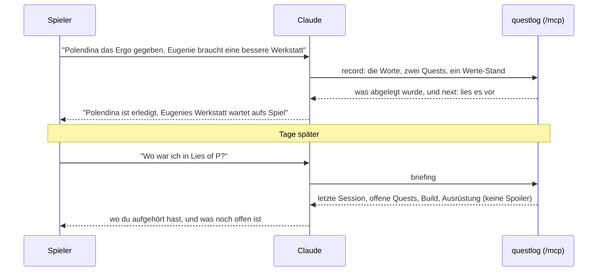

---
hide:
  - navigation
  - toc
---

# Behalte, wo du in jedem Spiel stehst.

questlog ist Questlog, Build-Tracker und Inventar für die Spiele, die du spielst. Du erzählst es Claude beim Spielen; wenn du zurückkommst, sagt dir Claude, was noch offen ist. Es zeigt immer nur, was du schon gefunden hast.

[Einrichten](self-hosting/configuration.md){ .md-button .md-button--primary }
[Wofür es steht](values.md){ .md-button }

## So funktioniert es

Von oben gelesen: Der Spieler erzählt, Claude legt es über questlogs MCP-Endpunkt ab, und ein späteres Briefing bringt nur zurück, was der Spieler gefunden hat.

- **Erzählen statt eintippen.** Claude legt jede Spielsession über questlogs eingebauten MCP-Endpunkt ab: deine Worte, wie du sie gesagt hast, die Quests, die du begonnen oder abgeschlossen hast, deine Werte, dein Build und die Gegenstände, die du gefunden hast.
- **„Wo war ich?"** Ein Briefing gibt dir die letzte Session, die offenen Quests mit ihren nächsten Schritten, deinen aktuellen Build und deine Ausrüstung.
- **Keine Spoiler.** Jeder Quest-Eintrag und jeder Gegenstand hat eine Spoiler-Stufe, und eine einzige Funktion entscheidet, was du siehst. Hinweise erscheinen nur, wenn du danach fragst, hinter einer Warnung.
- **Dein Log gehört dir.** Jeder, der sich anmeldet, hat seine eigenen Spiele und Durchläufe; niemand sonst auf der Instanz sieht sie.
- **Jedes Spiel.** Wertenamen und Inventargruppen sind Daten, in der Sprache des Spiels neben dem Englischen.
- **Ein Container.** Next.js und SQLite auf deinem eigenen Server; nichts telefoniert nach Hause.
