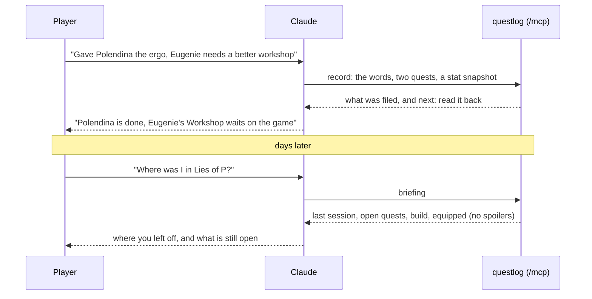

---
hide:
  - navigation
  - toc
---

# Remember where you are in every game.

questlog is a quest log, build tracker and item list for the games you play. You tell Claude while you play; when you come back, Claude tells you what you left open. It only ever shows what you have already found.

[Set it up](self-hosting/configuration.md){ .md-button .md-button--primary }
[What it stands for](values.md){ .md-button }

## How it works

Read it from the top: the player talks, Claude files through questlog's MCP endpoint, and a later briefing comes back with only what the player found.

- **Capture by talking.** Claude files each play session through questlog's built-in MCP endpoint: your words as you said them, the quests you started or finished, your stats, your build and the items you found.
- **"Where was I?"** A briefing gives you the last session, the open quests with their next steps, your current build and what is equipped.
- **No spoilers.** Every quest entry and item has a spoiler level, and one function decides what you see. Hints show only when you ask for them, behind a warning.
- **Your log is yours.** Everyone who signs in has their own games and playthroughs; nobody else on the instance sees them.
- **Any game.** Stat names and item kinds are data, kept in the game's own language next to the English.
- **One container.** Next.js and SQLite on your own server; nothing calls home.
