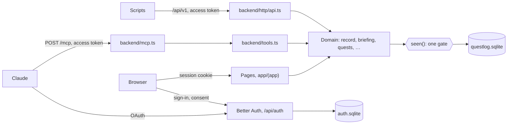
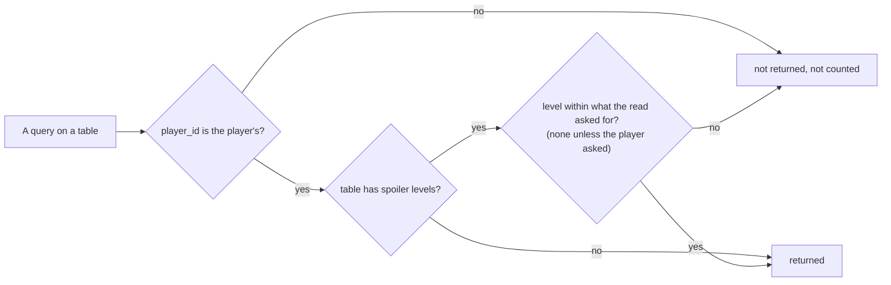

# How it works

questlog is one Next.js app in one container. Four kinds of callers reach one framework-free domain layer in `backend/`, which reads and writes two SQLite files.

Follow a call from the left: whichever way it comes in, it ends in a domain function, and every read of the log passes the gate.

## Surfaces

- **`/mcp`** checks the access token with `@better-auth/mcp` (signature, issuer, audience `/mcp`, expiry) and that the player still exists, then runs the tool as that player. The browser's cookie never counts there.
- **`/api/v1`** checks its own access token the same way, with audience `/api/v1` ([ADR 0007](../adr/0007-rest-api-tokens.md)), and serves the route table in `backend/http/api.ts`, from which `openapi.json` is generated. A token for `/mcp` and the browser's cookie don't count there.
- **The pages** in `app/(app)` get the player from Better Auth's session cookie and call the same domain functions, through `backend/index.ts` only (ESLint enforces it). They form one book (`app/(app)/book`): a contents page, then a page per playthrough, most recently played first. `components/Pages.tsx` lays them side by side with CSS scroll-snap, so a phone swipes between them and each scrolls on its own; arrow keys and side arrows turn them on a desktop. Each keeps its address, `/p/<id>`, which follows the page with `history.replaceState`.
- **`/api/auth`** is Better Auth: email codes, OpenID Connect providers, sessions, and the OAuth server for MCP clients. Its tables are in `auth.sqlite` ([ADR 0004](../adr/0004-sign-in-with-better-auth.md), [ADR 0006](../adr/0006-better-auth-wiring.md)).

## The gate

`seen()` in `backend/spoilers.ts` narrows every query: a row reaches a player only when its `player_id` is theirs, and, for quests, quest entries and items, only when its spoiler level is one the read asked for ([ADR 0005](../adr/0005-spoiler-levels-and-one-gate.md)).

A briefing never asks for more than `none`; `open_threads`, `item`, `missed` and the playthrough page do only when the player asked, and `missed` can't be called without asking. `correct` looks up the row it changes through the gate too, so another player's id is not found.

## Data

`questlog.sqlite` holds games (with their stat names and inventory groups as data), playthroughs, sessions (the transcript), quests and their entries, build plans, goals ([ADR 0009](../adr/0009-goals-and-the-character.md)), stat snapshots, items (the inventory, with counts and numbers) and the codex of bosses, enemies, NPCs and places, linked by what an item is good or bad against ([ADR 0010](../adr/0010-the-tracker.md)), and a game's tags with the items, codex entries and quests that carry them ([ADR 0014](../adr/0014-tags.md)); a playthrough also holds its character. Migrations live in `backend/db/migrations.ts`; a shipped one is never edited. Deleting a player in Better Auth deletes their log in a hook, since there is no foreign key across the two files.
