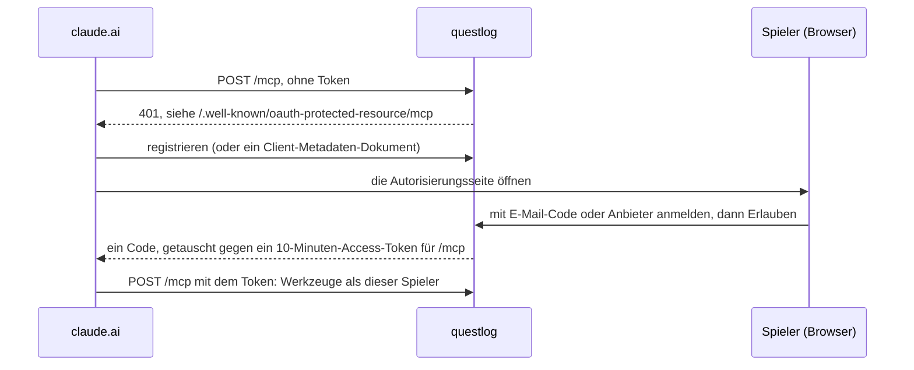

# Claude verbinden

questlogs MCP-Endpunkt ist `${PUBLIC_URL}/mcp`. Öffne in claude.ai _Einstellungen → Connectors → Eigenen Connector hinzufügen_ und gib diese Adresse an. Claude registriert sich, schickt dich zu questlogs Anmeldeseite und bittet dich, die Verbindung zu erlauben.

Claude erneuert das Token selbst; du meldest dich einmal an. Ein Token gilt nur für `/mcp`, und nur für den Spieler, der sich angemeldet hat.

Dann erzähl Claude, was du spielst. Es legt jede Session mit `record` ab und beantwortet „Wo war ich?" mit `briefing`. Die Werkzeuge stehen unter [MCP-Werkzeuge](../reference/mcp-tools.md) (auf Englisch).
