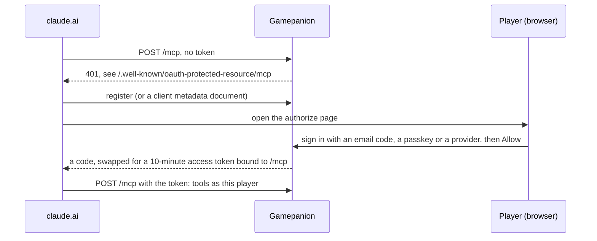

# Connect Claude

Gamepanion's MCP endpoint is `${PUBLIC_URL}/mcp`. In claude.ai, open _Settings → Connectors → Add custom connector_ and give it that address. Claude registers itself, sends you to Gamepanion's sign-in page, and asks you to allow the connection.

Claude refreshes the token by itself; you sign in once. A token only works on `/mcp`, and only for the player who signed in.

Then tell Claude what you are playing. It files each session with `record`, and answers "where was I?" with `briefing`. The tools are on [MCP tools](../reference/mcp-tools.md).
